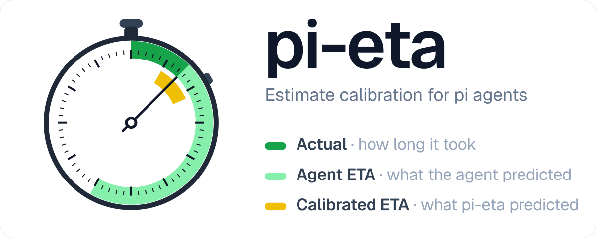
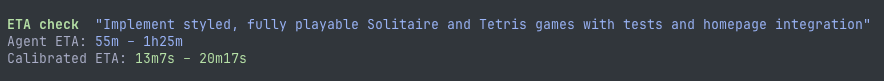
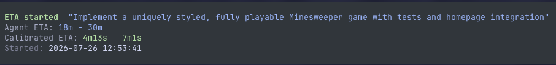
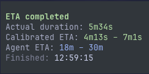
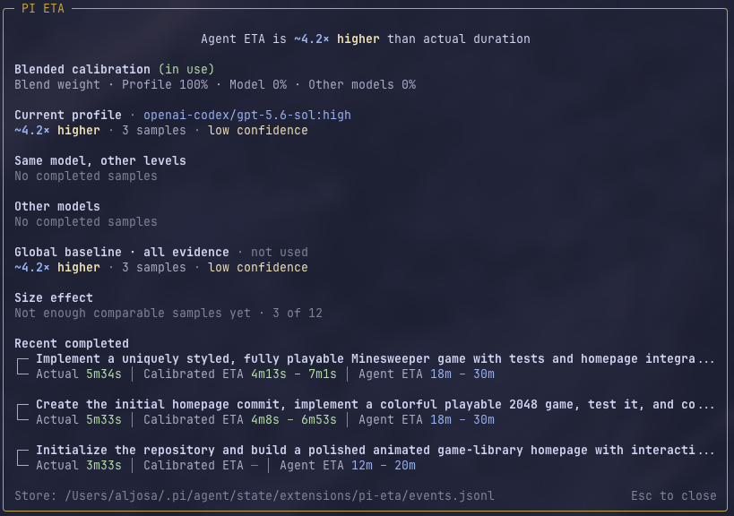

# pi-eta

<p align="center">
  
</p>

Estimate calibration for [pi](https://pi.dev) agents.

Agents are terrible at estimating how long things will take. `pi-eta` fixes that by having the agent give an estimate, measuring how long the work actually takes, and building calibration from the difference so the ETA you see is corrected.

The agent hands over its estimate and only gets a confirmation back. The calibrated ETA, the multiplier, and the confidence stats are shown only to you. If the agent knew it always runs 3x over it could start padding its estimates, and then calibration would be training on padded numbers.

## Install

```bash
pi install npm:pi-eta
```

## Tools

| Tool         | Description                                                              |
| ------------ | ------------------------------------------------------------------------ |
| `eta_check`  | Privately show the user a calibrated estimate without starting a timer   |
| `eta_start`  | Start a wall-clock ETA timer from the agent's own estimate               |
| `eta_update` | Refresh the countdown with an honest estimate of work remaining          |
| `eta_finish` | Close an ETA timer as completed, abandoned, scope-changed, or superseded |

The agent only receives confirmation text. Calibrated estimates, multipliers, confidence, and spread are rendered to the user through tool UI details.

<p align="center">
  
  <br />
  <sub><em>eta_check</em></sub>
</p>

---

<p align="center">
  
  <br />
  <sub><em>eta_start</em></sub>
</p>

<p align="center">
  
  <br />
  <sub><em>eta_finish</em></sub>
</p>

## Live countdown

For substantial tasks, usually work expected to take more than about a minute, the agent is instructed to estimate the whole task before starting. The estimate includes discovery, validation, delegated agents, and expected waiting. Parallel branches contribute their longest critical path; sequential work and integration add to it.

Each user-initiated run also receives a hidden start reminder at its first normal model call when no ETA task is already open. It includes a valid `eta_start` JSON example and permits trivial immediate tasks to skip estimation. If the agent starts business tools without an estimate, the next normal model call gets one final reminder to estimate only the work still remaining, without repeating completed work. These reminders do not start extra model calls, block tools, or replace the original task. An existing ETA task uses remaining-work update reminders instead.

Before the agent supplies an estimate, the widget shows `ETA pending · awaiting an agent estimate`, with no invented duration. If `eta_start` is inactive, it shows `ETA unavailable · eta_start is inactive`, and no start instructions are injected. If both reminders go unanswered, the next model call shows `ETA no estimate supplied`. A valid start replaces the pending state with the real countdown. Successful timing, finishing, and resetting close the start-reminder state for that run; later context calls do not restart it. Run end, session replacement, and shutdown clear the pending UI. Reminders help models notice estimation, but cannot guarantee that every model will call the tool.

Timing instructions mention only the ETA tools active in the current run. An already-open countdown continues to show real remaining time if `eta_update` is disabled, with `update unavailable` in the widget. It does not ask for an unavailable update or finish tool. Re-enabling updates preserves the pending refresh request rather than silently postponing it.

A compact, detailed widget below the input editor refreshes every second. In the terminal UI this is the single live ETA display: the footer status is cleared so the time is not repeated. It leaves Pi's working indicator available for other extensions such as `elapsed`. RPC mode does not support component widgets, so it uses a single status fallback instead:

```text
ETA 2m12s remaining · Implement and verify
Subagents (latest estimates): Research ~2m; Tests ~1m
```

The countdown uses the calibrated range when history is available, otherwise the agent's raw range. At halfway to the range's early bound, or after two minutes for longer estimates, a hidden reminder asks the agent to reassess the remaining work at its next normal model call. Updates restart the countdown from the new remaining estimate, and schedule the next reminder. Reminders are deduplicated between model calls; an unanswered reminder can repeat after two minutes. Substantial progress or delegation changes also call for a fresh estimate.

`eta_update` records a separate update event. The initial `eta_start` estimate and the task's total elapsed duration remain the calibration sample; updates never replace that baseline. Both tools accept an optional `delegatedTasks` list of `{ taskSummary, estimateMinutes }` entries for the widget. These are the delegated agents' latest raw remaining estimates, already included in the parent's total. They are a snapshot rather than independently running child timers. An update with `delegatedTasks: []` clears completed subagents; omitting the list preserves the previous breakdown.

When [pi-subagents](https://www.npmjs.com/package/pi-subagents) emits its public background start/completion events, the extension keeps the parent's countdown running while its background agents work between parent turns. Completion requests a fresh assessment at the next ordinary model call. Session identity is checked so another session's children do not affect this countdown. This event integration is optional: child processes do not share the parent's extension runtime, and child ETA estimates are reported by agents through the parent's tools rather than read from private subagent files.

The clock never starts model turns or interrupts an ongoing tool or provider request. If work runs past the estimate before a new tool opportunity, the widget honestly shows `ETA exceeded · update needed`; it never goes negative or invents extra time. A parent turn ending without tracked background work pauses the UI clock and requests a new estimate on resume. Finishing, resetting, switching sessions, reloading, or shutting down clears its interval and widget.

## Commands

| Command               | Description                                       |
| --------------------- | ------------------------------------------------- |
| `/eta`                | Open the Pi ETA stats overlay                     |
| `/eta stats`          | Same as `/eta`                                    |
| `/eta verbose`        | Toggle persistent verbose tool output             |
| `/eta verbose on`     | Enable persistent verbose tool output             |
| `/eta verbose off`    | Disable persistent verbose tool output            |
| `/eta verbose status` | Show whether persistent verbose output is enabled |
| `/eta reset`          | Confirm and append a reset marker                 |

Verbose output is disabled by default. Pressing Ctrl+O on a Pi ETA tool temporarily shows the same details as verbose mode without changing the saved preference. `/eta reset` does not delete the raw event log; it appends a reset event and excludes earlier data from future calibration.

<p align="center">
  
  <br />
  <sub><em>/eta</em></sub>
</p>

## Calibration

Calibration is tracked separately for each model and thinking level combination, since the same model at `low` and at `xhigh` behaves very differently against the clock.

How the multiplier, blending, and the size effect are computed is in [CALIBRATION.md](CALIBRATION.md).

## Storage

Events and display settings are stored globally under the Pi agent directory:

```text
~/.pi/agent/state/extensions/pi-eta/events.jsonl
~/.pi/agent/state/extensions/pi-eta/settings.json
```

Event writes are append-only and protected with a small lock directory so multiple Pi sessions can record events safely. Settings are written atomically and persist across sessions and Pi restarts.

### Advanced calibration settings

Calibration policy is configured directly in `settings.json`; run `/reload` after editing it:

```json
{
  "verbose": false,
  "calibrationMode": "blended",
  "profileSampleThreshold": 3
}
```

| Mode                | Behavior                                                                   |
| ------------------- | -------------------------------------------------------------------------- |
| `blended`           | Default. Shrink the exact profile through its model toward other models.   |
| `profile`           | Strictly use the current model and thinking level, with no fallback.       |
| `global`            | Strictly use calibration across all eligible completed tasks.              |
| `profile-threshold` | Use global calibration until the profile reaches `profileSampleThreshold`. |

`profileSampleThreshold` must be a positive integer, defaults to `3`, and is ignored outside `profile-threshold` mode. Invalid settings fall back to the defaults.

## Behavior notes

- Calibration uses wall time: `eta_finish - eta_start`.
- Only `outcome=completed` trains calibration.
- `abandoned`, `scope_changed`, and `superseded` close the timer but are excluded from calibration.
- Changing the model or thinking level while a task is open records one durable marker. Such mixed-profile tasks stay in history and in the overlay but train nothing.
- One ETA task may be open per Pi session.
- `eta_update` can only update an open task in the current session.
- Live countdown updates use ordinary agent turns; long blocking calls may delay reassessment.
- Agents are instructed not to infer or restate hidden calibrated values.

### Known limitation

Calibration measures wall time, which for long tasks can include user pauses, waiting between turns, and overnight gaps. That inflates long-task durations and can exaggerate a measured size effect. Distinguishing active agent time from elapsed wall time is not implemented.

This will be implemented once [earendil-works/pi#7147](https://github.com/earendil-works/pi/issues/7147) is approved. Right now an extension can't know when an approval dialog is sitting open, and that issue adds the missing events around UI dialogs. Once it lands, calibration can use active agent time instead of raw wall time.

## Requirements

- Pi 0.82.1 or newer.
- Node.js 22.19 or newer.
